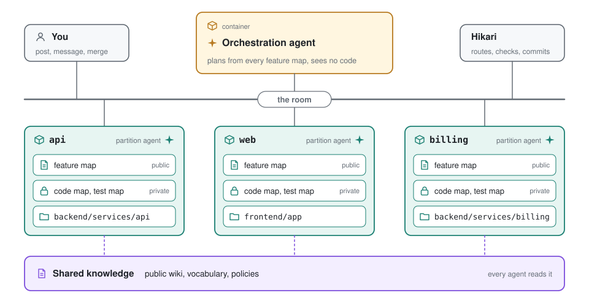
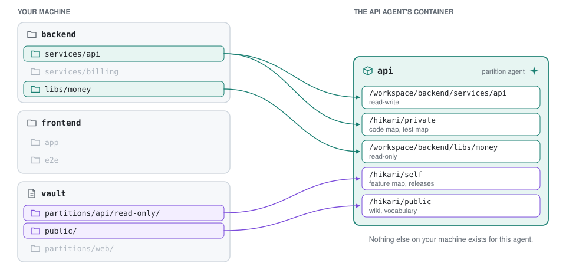
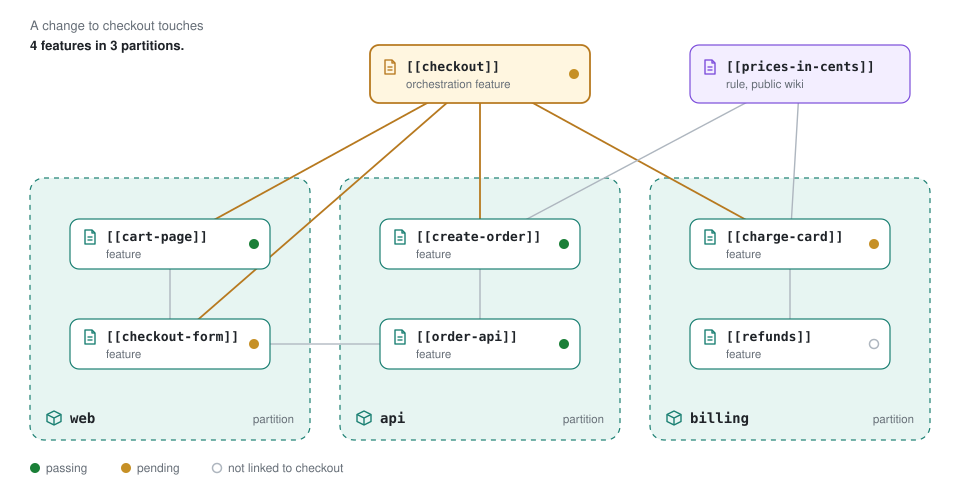
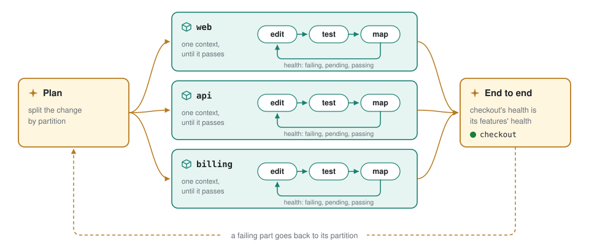

# Hikari

**Context engineering for teams of Claude Code agents.**

<picture>
  <source media="(prefers-color-scheme: dark)" srcset="docs/images/overview-dark.svg">
  
</picture>

Hikari splits your code into partitions and gives each partition to its own Claude Code agent, in its own Docker container. Each agent masters one small piece of your ecosystem and sees no other code. An orchestration agent plans from what the partition agents know, and together they work as a collective intelligence: a team that can change a whole ecosystem without any one agent holding all of it in context.

Status: in development.

## Why Hikari

I built Hikari after three problems kept coming back while I built a product ecosystem with agents.

- **Blended work.** I would ask for a reusable backend API, as an abstraction in the backend, and the agent would patch the client as well. The API came out shaped by its one caller, with fixes on both sides.
- **Rebuilt tools.** My ecosystem is too large for one context window, so agents in different repositories rebuilt the same tools.
- **Unknown reach.** I could never say how many code surfaces one feature change would touch.

More precise instructions fixed none of these. Hikari's answer is to change what each agent can see.

## How It Works

### Context Engineering

Prompt engineering asks what to tell an agent. Context engineering asks what the agent should see. Hikari moves your effort to the second question: you decide which folders, documents, and knowledge each agent is exposed to, and the container enforces it.

A partition agent mounts its own folders, its private code map and test map, and the shared knowledge. The orchestration agent mounts the feature map of every partition and no code at all. An agent cannot blend work across a boundary it cannot see, so no instruction has to say "leave the client alone."

<picture>
  <source media="(prefers-color-scheme: dark)" srcset="docs/images/context-dark.svg">
  
</picture>

### A Network of Features

Each partition agent writes a feature map of its code: one short Markdown document for each feature, principle, and rule, linked to the others with `[[id]]` like a wiki. The orchestration agent writes features that span partitions, such as checkout, and links each one to the partition features it is made of. The links join every feature map into one network of your ecosystem's features, which you can open as a single Obsidian vault.

The reach of a change is then something you read: follow the links from the feature you want to change.

<picture>
  <source media="(prefers-color-scheme: dark)" srcset="docs/images/network-dark.svg">
  
</picture>

### Tight Validation Loops

A partition agent works inside its small context until its own tests pass. Hikari computes each feature's health from the tests that touch it (failing, pending, untested, or passing), so the agent never reports its own result. Once each part passes, the orchestration agent brings the change together end to end. A feature that spans partitions takes its health from the features it links, so one failing part sends the work back to the partition that owns it.

<picture>
  <source media="(prefers-color-scheme: dark)" srcset="docs/images/loops-dark.svg">
  
</picture>

## Quickstart

You need Claude Code, Docker, and a Claude subscription or an Anthropic API key. Install the Hikari plugin in Claude Code:

```
/plugin marketplace add nathanaday/hikari
/plugin install hikari@hikari
```

Then open Claude Code in the folder that holds your repositories, and ask in your own words:

```
Take these repos, build a hikari-friendly topology, and start working in hikari containers.
```

The plugin's `hikari` skill takes it from there. On first use it installs the hikari binary of the plugin's version, checks Docker with `hikari doctor`, and makes a project for your repositories. Then it walks you through each stage of [onboarding](#bring-your-own-repositories), asking before each step that changes anything. The binary goes in `~/.hikari/bin`; `hikari doctor` gives you the one `sudo` line that puts it on your terminal's PATH, where you run `hikari up`.

`hikari up` prints the address of the web UI. Open it to post in the room, watch each agent's turns as they happen, and browse the feature maps. The address holds a secret token, so do not share it. Press Ctrl-C to stop every container.

To try the shop example from a checkout of this repository, you also need Go 1.26 or later and Node.js 22.12 or later:

```sh
claude setup-token                                 # make a long-lived token
echo 'CLAUDE_CODE_OAUTH_TOKEN=sk-ant-oat01-...' > .env
make demo-repo                                     # a small shop repository to work on
make up                                            # build Hikari and start the shop's agents
```

`make install` puts your build of the checkout where the plugin runs it, so the plugin and your terminal both use it.

## A Project Is One File

A project is one topology file: a Docker Compose file whose `x-hikari` keys Compose ignores. Compose describes each agent's container, and the `x-hikari` keys describe the orchestration agent and each agent's partition.

```yaml
name: shop

x-hikari:
  orchestration: conductor
  repos:
    backend: {path: ~/code/backend, branch: hikari}

x-agent: &agent
  environment: [CLAUDE_CODE_OAUTH_TOKEN]

services:
  conductor:
    <<: *agent
    image: hikari-agent
    x-hikari: {description: Plans changes across the shop.}

  api:
    <<: *agent
    build: {context: ., dockerfile: python.Dockerfile}
    x-hikari:
      description: The order API.
      partition:
        folders:
          - {repo: backend, path: services/api}
          - {repo: backend, path: libs/money, read_only: true}
        test: pytest -q backend/services/api -p no:cacheprovider --junitxml=/hikari/private/reports/all.xml
```

Save it as `topology.yaml` and run `hikari up`. Each folder appears in the agent's container at `/workspace/<repo>/<path>`, and the test command runs in `/workspace`. Agents never touch git: Hikari commits each agent's changes to the branch that the file names for each repository, with the agent as author, and you review and merge it.

## Bring Your Own Repositories

Onboarding turns your repositories into a project through two skills of the plugin, which the `hikari` skill hands you to. `containerize-repo` wraps each repository as one partition, with no change to its code, and hikari's agents record a baseline of every test. `hikify` works with you to draw cleaner partitions, plans the moves, has fresh reviewers check the plan, and carries it out. Before you commit to either, `propose-topology` sketches a topology from reading the code. After onboarding, `room` posts your requests to the agents from your session, and `change-topology` splits, merges, or adds partitions as the project grows. The [onboarding guide](docs/guides/onboarding.md) walks through each one.

## Learn More

- [Design notes](docs/design.md): the reason behind each decision
- [Glossary](docs/glossary.md): every Hikari term in one place
- [The vault](docs/guides/vault.md): where each file lives, and where each container sees it
- [Onboarding guide](docs/guides/onboarding.md): bring existing repositories into a project
- [Migration guide](docs/guides/migrating.md): move a project from before the glossary's words to now
- [Shop example](examples/shop/): two partitions and an orchestration agent
