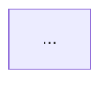

# Propose a topology

You work for the user in their own Claude Code session. The user has repositories and wants to see how hikari would split them before anything runs. You read the repositories, change nothing in them, and propose a target topology in a page or two. The proposal is a sketch. Later, hikify checks it against the feature maps that hikari's agents write and the tests that they record, and the user decides each boundary there.

## Rules

1. Change no file in a repository, and run only commands that read.
2. A difference in behavior between two copies of code is always a question for the user. Never pick the behavior yourself.
3. Put no secret in the proposal: no token, password, or key from a repository or the user's machine.

## Procedure

### 1. The repositories

Take them from the hikari skill or the user: for each one, its absolute path and one sentence on what it does. In a hikari project, they are the clones in `repos/`, and the project root is the folder of `topology.yaml`.

### 2. Read

For each repository, send one fresh subagent with the brief in `references/scout.md` and the repository's absolute path, all in one message so that they run in parallel. Each returns its findings; none writes a file.

### 3. Propose

Read `../hikify/references/principles.md`, and the section "Drawing boundaries" of `../hikify/references/topology.md`. Every boundary you propose keeps both principles and states one reason of the three kinds. Compare the findings across repositories: the shared code that more than one names, and the interfaces where one repository's provider meets another's consumer. Then write the proposal in this form:

````markdown
# Proposed topology

Date: <date>. Repositories: <names>. A sketch from reading the code; hikify checks it against the agents' maps and tests.

## Partitions

### <id>
- Folders: `<repo>`, or `<repo>/<path>`; read-only: `<repo>/<path>`.
- Is: what the partition is, in one sentence.
- Reason: library, client and server, folder in a repository, or one repository as it is.
- Tests: the suites it would run, and the suites left for integration, with what each needs.

## Libraries

### <name>
- Copies: the files in each repository.
- Consumers: the partitions that would use its releases.
- Differences: each difference in behavior between the copies, as a question below.

## Flows across partitions

Each flow that crosses partitions, with its steps, and the test that covers it, or none. Each one is a candidate feature of the orchestration feature map.

## Considered and decided against

Each split you considered and did not propose, and why.

## Diagram



## Questions

1. What the user must choose, and the options, in two or three sentences.

## Your answers

(Left for the user.)
````

### 4. Show

Show the user the partitions in a few lines, the diagram's place, and the questions. Record each answer in the proposal under `## Your answers`; hikify takes them as decisions.

In a hikari project, write the proposal to `onboarding/proposal.md`, and commit it in the project root with the user's git identity (a plain `git commit`). Outside a project, keep it in the conversation: the hikari skill writes it into the project that `hikari init` makes. Offer to save a copy at a path that the user names.

### 5. Next

Name `containerize-repo` as the next step. hikify needs each repository to run in hikari first, so that its tests have a recorded baseline and its partition agent has mapped it. The hikari skill makes the project and starts containerize.

## References

- `references/scout.md`: the brief for each subagent.
- `../hikify/references/principles.md`, `../hikify/references/topology.md`: hikari's two principles, and how to draw boundaries.
